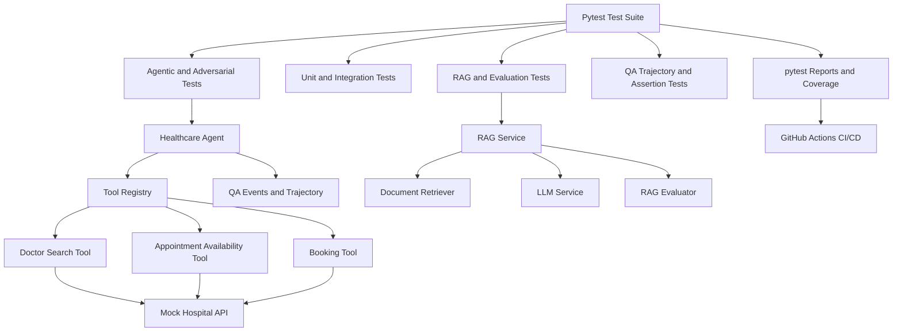

# Healthcare Agentic AI Testing Framework

A Python-based QA automation framework for testing healthcare appointment agents, tool execution, Retrieval-Augmented Generation (RAG), and AI safety behaviors.

## Project Overview

This project demonstrates how to validate an AI agent that interacts with healthcare services to search for doctors, check appointment availability, and manage booking requests.

The framework focuses on functional correctness, integration behavior, adversarial scenarios, RAG response evaluation, and traceable agent execution.

## Key Features

- **Agentic AI testing:** Validate agent decisions, tool execution, stopping conditions, and booking outcomes.
- **Adversarial testing:** Test unknown tools, malformed actions, invalid dates, duplicate bookings, and attempts to bypass confirmation.
- **RAG evaluation:** Evaluate groundedness, relevance, abstention, and source validity.
- **Integration testing:** Validate interactions with a mock hospital API and the RAG pipeline.
- **QA assertions and trajectory recording:** Verify tool calls, agent decisions, execution events, and booking outcomes.
- **Automated test reporting:** Generate HTML test reports and code coverage reports.
- **CI/CD integration:** Run automated tests using GitHub Actions.

## Technology Stack

- Python 3.13
- pytest
- pytest-cov
- pytest-html
- Git and GitHub
- GitHub Actions
- Retrieval-Augmented Generation (RAG)
- Agentic AI testing techniques

## Project Structure

```text
healthcare-agentic-ai-testing/
├── .github/
│   └── workflows/
│       └── tests.yml
├── src/
│   ├── agent/
│   ├── qa/
│   ├── rag/
│   ├── services/
│   └── tools/
├── tests/
│   ├── agentic/
│   ├── evaluation/
│   ├── integration/
│   ├── qa/
│   ├── rag/
│   ├── tools/
│   └── unit/
├── reports/
├── htmlcov/
├── pytest.ini
└── README.md
```

*Note: The structure above summarizes the main project areas. Adjust it to match the actual folders and files in your repository.*

## Testing Strategy

| Test category | Purpose |
|---|---|
| Unit testing | Validate individual tools and services |
| Agentic testing | Verify agent decisions and tool execution |
| Adversarial testing | Check behavior under malformed or unsafe inputs |
| Integration testing | Validate interactions between components |
| RAG evaluation | Check answer grounding, relevance, abstention, and sources |
| Trajectory testing | Verify agent execution events and outcomes |

## Example Safety Scenarios

- Reject a booking without explicit Boolean confirmation.
- Reject an unknown tool without crashing.
- Prevent duplicate bookings for the same appointment slot.
- Reject invalid or past appointment dates.
- Avoid generating answers unsupported by retrieved context.
- Reject fabricated or invalid source references.
- Record rejected operations in the agent trajectory.

## Running the Tests

Create and activate a virtual environment if one is not already active.

On Windows PowerShell:

```powershell
python -m venv .venv
.\.venv\Scripts\Activate.ps1
python -m pip install -r requirements.txt
```

Run the complete test suite:

```powershell
python -m pytest
```

## Generating Reports

Generate the HTML test report and code coverage report:

```powershell
python -m pytest --cov=src --cov-report=term-missing --cov-report=html --html=reports/pytest-report.html --self-contained-html
```

Open the reports:

- Test report: `reports/pytest-report.html`
- Coverage report: `htmlcov/index.html`

## CI/CD Pipeline

GitHub Actions is configured to run automated tests when changes are pushed and when pull requests are created.

The workflow supports:

- Automated test execution
- Test result verification
- Code coverage enforcement through quality gates
- HTML report artifacts for inspection

See `.github/workflows/tests.yml` for the workflow configuration.

## Latest Test Results

The recorded GitHub Actions HTML report showed:

- Total tests: 130
- Passed: 130
- Failed: 0
- Errors: 0
- Skipped: 0

These results describe the reported execution on 19 October 2026. New runs may produce different results.

## Future Improvements

- Expand branch and edge-case coverage.
- Add mutation testing to evaluate test effectiveness.
- Introduce additional AI evaluation metrics.
- Add dependency vulnerability scanning.
- Improve automated test trend reporting.
- Prepare a reproducible end-to-end portfolio demonstration.

## Author

QA Automation and AI Testing Portfolio Project

This project demonstrates practical approaches to testing agentic AI workflows, RAG pipelines, tool safety, and CI/CD-based quality assurance.

## Architecture

The framework tests a healthcare appointment agent and its supporting
tools, RAG pipeline, evaluation logic, and QA observability components.



### Main components

- **Healthcare Agent:** Processes actions and coordinates tool execution.
- **Tool Registry:** Manages the registered healthcare tools.
- **Healthcare Tools:** Support doctor search, availability checks, and booking.
- **Mock Hospital API:** Provides the simulated healthcare service.
- **RAG Service:** Combines document retrieval and language-model responses.
- **RAG Evaluator:** Checks grounding, relevance, abstention, and source validity.
- **QA Observability:** Records execution events and validates agent behavior.
- **CI/CD:** Runs automated tests and makes reports available for inspection.

## Quality Gates

The framework uses automated quality checks to help prevent regressions.

- **Test execution:** The pipeline fails when an automated test fails.
- **Coverage threshold:** The configured minimum coverage requirement is enforced during test execution.
- **Test reports:** HTML and machine-readable reports support debugging and result analysis.
- **Continuous integration:** GitHub Actions runs the configured checks on repository events.

A successful pipeline indicates that the configured checks passed for that run. Code coverage alone does not guarantee complete test coverage or defect-free behavior.
